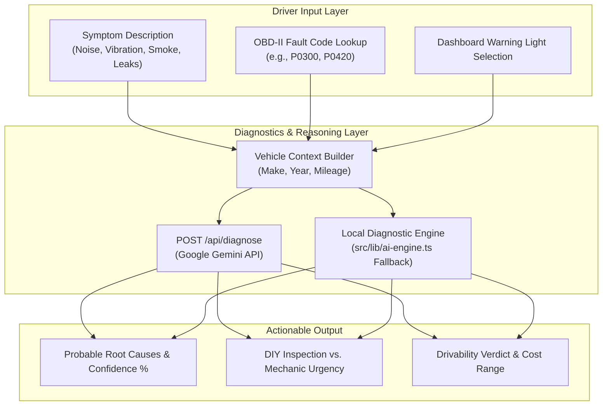

<div align="center">

  

  <p align="center">
    <b>AI-powered vehicle diagnostics platform featuring symptom-based root-cause triage, instant OBD-II fault code decoding, dashboard warning light reference, and emergency roadside checklists.</b>
  </p>

  <p align="center">
    
    
    
    
    
    <a href="LICENSE"></a>
  </p>

</div>

---

## Core Capabilities

| Module | Overview | Practical Impact |
| :--- | :--- | :--- |
| **AI Symptom Reasoner** | Conversational triage via Google Gemini (`GEMINI_API_KEY`) with automatic fallback to a deterministic local engine (`src/lib/ai-engine.ts`). | Translates driver symptoms into ranked root causes, drivability checks, and repair cost estimates. |
| **DTC & OBD-II Decoder** | Searchable fault database covering standard Powertrain (`P`), Body (`B`), Chassis (`C`), and Network (`U`) diagnostic codes. | Explains fault triggers, severity levels, and inspection steps clearly. |
| **Emergency SOS & Roadside Triage** | Guided safety checklist, breakdown protocols, and recovery assistance locator. | Provides clear immediate steps during roadside emergencies. |
| **Warning Light Reference** | Interactive catalog of dashboard cluster indicators grouped by urgency (Critical Stop, Service Soon, Advisory). | Identifies unfamiliar warning icons and recommended actions quickly. |
| **Vehicle & Brand Explorer** | Browse supported vehicle makes, common model faults, and tailored maintenance guides. | Organizes vehicle-specific diagnostic data in one place. |

---

## Diagnostic Pipeline Architecture



<details>
<summary><b>Project Structure</b></summary>

```text
AutoAid-AI/
├── src/
│   ├── app/
│   │   ├── api/diagnose/      # Serverless Gemini diagnostic route handler
│   │   ├── assistance/        # Roadside assistance & recovery locator
│   │   ├── diagnose/          # Interactive AI symptom diagnostic UI
│   │   ├── emergency/         # Emergency SOS protocol & safety checklist
│   │   ├── faults/            # OBD-II / DTC fault database & detail views
│   │   ├── search/            # Global fault & vehicle search
│   │   ├── vehicles/          # Supported brands & model guides
│   │   └── warning-lights/    # Instrument cluster warning light catalog
│   ├── components/            # Layout & reusable UI components
│   ├── data/                  # Vehicle, brand, fault & warning-light datasets
│   ├── lib/                   # Local diagnostic engine & utility helpers
│   └── types/                 # Shared TypeScript interfaces
├── scripts/                   # Data maintenance utilities
├── .env.example
└── package.json
```

</details>

---

## Getting Started

### Prerequisites
- **Node.js 20+** and **npm**

### 1. Clone & Install
```bash
git clone https://github.com/Sh3hann/AutoAid-AI.git
cd AutoAid-AI
npm install
```

### 2. Configure Environment (Optional)
Copy `.env.example` to `.env.local` and add a Google Gemini API key from [Google AI Studio](https://aistudio.google.com/):

```bash
cp .env.example .env.local
```

```env
GEMINI_API_KEY=your_gemini_api_key_here
```

> **Offline / Keyless Mode:** If `GEMINI_API_KEY` is omitted, AutoAid AI runs using its built-in local symptom-correlation engine (`src/lib/ai-engine.ts`).

### 3. Run & Build
```bash
npm run dev     # Start local dev server at http://localhost:3000
npm run lint    # Run ESLint checks
npm run build   # Create production build
```

---

## License

Released under the [MIT License](LICENSE) © 2026 [Akil Shehan](https://github.com/Sh3hann).

<div align="center">

<a href="https://itzshehan.xyz/"></a>
<a href="https://www.linkedin.com/in/akil-shehan"></a>
<a href="https://github.com/Sh3hann"></a>

</div>
